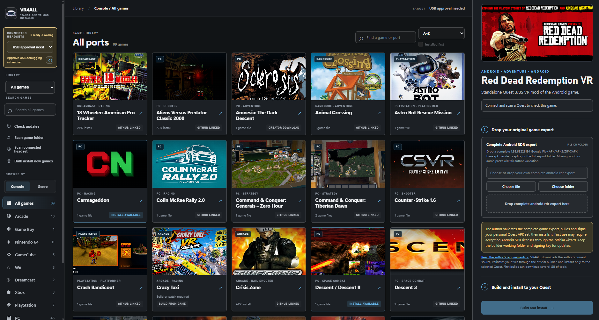
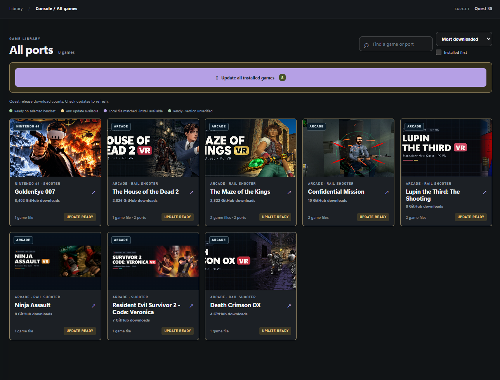

# VR4ALL

### Standalone VR Mod Installer for Meta Quest

[☕ Donate to VR4ALL](https://ko-fi.com/vr4all)

**One hub for ALL standalone Quest VR ports. One-click installs. Auto update installed mods.**

## 🎮 Current number of supported game projects: 116

The catalog has **116 game cards and 123 port choices**, including alternate mods for Time Crisis, Pokémon, Halo, and Virtua Cop. Each card explains its setup requirements; Quest model support varies by port.

Project Honeydew can be installed from its checksum-verified creator APK with your own Pikmin disc. Deus Ex is listed as an **in-development project**; its creator has not published a playable Quest release, so VR4ALL links the project without offering an install.

## What VR4ALL does

- 🧭 **One hub for ALL standalone Quest VR ports.** Browse 116 game projects in VR4ALL, search by game, console, or genre, and find each mod creator's project in one place.
- ⚡ **Simple, one-click installation.** Bring the game files or creator APK requested on the card, then click **Install**. VR4ALL handles the build, patch, and headset transfer steps in the app, so players do not need to follow a separate build guide.
- 🔄 **Auto update installed mods.** Scan your connected Quest to find new creator releases, then approve the updates you want VR4ALL to install on the headset.
- 🖥️ **Update VR4ALL itself.** The desktop app checks for its own release when it opens and after **Check updates**. Approve a newer release to download, restart, and reopen the portable app with your settings intact.
- 📦 **Bulk install and bulk update.** Choose or drop game files on their individual cards; VR4ALL remembers the original paths. Select saved, ready games in Bulk install, or update eligible installed mods together without supplying files already on the headset.

### Updates on a connected Quest

VR4ALL finds newer creator APKs for installed mods and marks the games that can be updated. Choose **Update all installed games** to install the available updates in sequence.

Installed standalone ports run on your Quest without PC streaming. VR4ALL does not include commercial game files or port APKs that creators distribute only through manual downloads.

> **Early beta:** Ports have different requirements, and some workflows have not been tested end to end on every Quest model. Read the notes on each game card and report problems you find.

## Get started

1. Download `VR4ALL-win-x64.exe` from [Releases](https://github.com/vr4all-standalone/vr4all-standalone/releases). Versions through 0.3.51 need this one manual download to repair their self-updater.
2. Enable Developer Mode on your Quest, connect it with a USB data cable, and approve **USB debugging** inside the headset.
3. Open VR4ALL and select your headset above the library.
4. Choose a game and add the files requested on its card from a copy you own. VR4ALL shows whether it accepts the input and any extra preparation needed.
5. Choose the supported creator APK source, or provide an APK downloaded from the creator, then click **Install**. Launch the port from your headset's app library.

For build requirements, archive formats, bulk installation, update behavior, and individual port notes, see the [user guide](docs/user-guide.md).

RDR requires a complete Android game export and an engine supported by the mod's builder. Its phone-export window checks available game-data entries before copying when Android supports inspection. Either Google Play or Netflix may need separate matching world/audio packs if the phone keeps them private. VR4ALL explains missing data and accepts your existing files; it does not include or download those packs. Keep the Quest online for first launch and any Netflix sign-in.

## Requirements

- Windows x64 PC.
- A Meta Quest supported by the chosen port, a USB data cable, Developer Mode, and USB debugging.
- Your own legally obtained game files for any port that requires them.

VR4ALL does not include ROMs, paid games, disc images, or commercial game data. A successful transfer confirms files reached the headset; test the port in the headset to confirm it plays correctly.

## Help improve VR4ALL

[Report a problem](https://github.com/vr4all-standalone/vr4all-standalone/issues/new/choose) if a port fails to install, reports the wrong status, or links to an outdated creator release. Include the port name, headset model, VR4ALL version, and a redacted log. [Suggest a standalone port](https://github.com/vr4all-standalone/vr4all-standalone/issues/new/choose) if the library is missing one.

Please do not attach copyrighted game files, headset serial numbers, or personal file paths to public issues.

VR4ALL is an independent community frontend. It is not affiliated with Meta, game publishers, or the port creators. The ports belong to their creators; each game card links to the creator's project or download page.

Catalog image sources are listed in [artwork sources](docs/art-sources.md). These images identify the games and community ports; VR4ALL does not claim ownership of third-party artwork.
